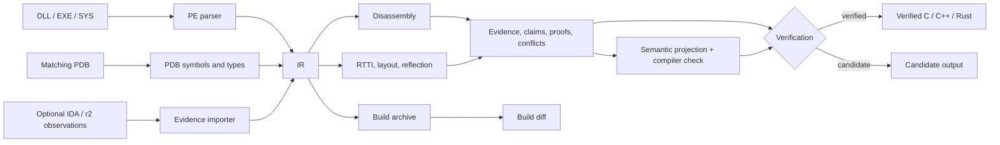

# Architecture

Windissect keeps three things apart: what it observed in the binary, what it
claims from those observations, and what it is willing to emit as callable
code. An observation only becomes a usable declaration once its proof passes.

## Pipeline

1. **PE identity.** Machine type, image base, timestamp, sections, exports,
   ordinals, forwarders, imports, relocations, CodeView GUID and age, SHA-256.
2. **PDB extraction.** The PDB is checked against the PE, then public symbols,
   module procedures, thunks, data and type records are collected.
3. **Demangling.** MSVC names become structured signatures. The raw text is
   kept when parsing fails.
4. **Enrichment.** Architecture-aware disassembly gives function ranges, body
   hashes, direct calls, imports and jump thunks.
5. **RTTI, layout and reflection.** Vftables, member-access observations,
   allocation sizes and property metadata.
6. **Evidence graph.** Evidence, claims, proofs and conflicts are stored in
   the IR alongside the data.
7. **Semantic projection.** Class and union layouts, inheritance, vtable order
   and enums are projected into separate verified and candidate models, then
   compiled as C++ and Rust to check them.
8. **Emission.** C/C++, Rust, symbol tables, assembly, documentation and
   evidence reports are generated from the IR only.
9. **History.** Immutable per-build snapshots and diffs between adjacent
   builds.

## Trust rules

- A PDB whose GUID and age don't match the PE is rejected.
- Code for an unsupported architecture is never decoded as another one.
  Metadata is still extracted, disassembly-based analysis is withheld.
- Forwarded exports and data are never disassembled as functions.
- Unknown types stay explicitly unknown.
- A claim is verified only when evidence exists, every proof obligation passes
  and no open conflict names it.
- Callable C++ and Rust helpers also need verified address and signature
  claims for the same symbol.
- Reference headers from other projects can open a recovery job but can never
  verify one. Only evidence from the exact PE, PDB or disassembly can.
- Discovered functions are never called automatically. Runtime probing needs
  an explicit `--probe-manifest`, runs each call in its own helper process,
  and is DLL-only.
- Generated addresses are RVAs relative to the image base recorded in the IR.

## Modules

| Module | Responsibility |
|---|---|
| `main.rs` | CLI |
| `extract.rs`, `pdbsym.rs`, `pdbtype.rs` | PE identity and exports, PDB symbols, procedures and types |
| `demangle.rs`, `typeparse.rs` | MSVC demangling and type parsing |
| `enrich.rs` | Function boundaries, instructions, hashes, calls, thunks, imports |
| `rtti.rs`, `layoutinfer.rs`, `reflection.rs` | Vftables, member observations, reflection metadata |
| `model.rs` | IR: evidence, claims, proofs, conflicts, symbols, types, semantic facts |
| `verify.rs` | Graph and identity invariants, optional target profiles |
| `emit.rs`, `emit_rust.rs`, `emit_syms.rs` | C/C++ headers, call helpers, Rust, C symbol tables |
| `emit_evidence.rs`, `emit_asm.rs`, `docs.rs` | Evidence output, annotated assembly, Markdown docs |
| `diff.rs`, `history.rs` | Build diffs and per-build archives |
| `evidencepack.rs`, `oracle.rs` | Evidence pack validation, IDA/r2 imports checked against binary identity |
| `refine.rs`, `recovery_plan.rs` | Reference gap analysis, recovery jobs, recovery plan |
| `semantic.rs`, `semantic_emit.rs` | Semantic projection and verified/candidate C++ and Rust |
| `semantic_validate.rs`, `semantic_score.rs` | Compiler round-trips and precision scoring against an oracle |
| `semantic_probe.rs` | Isolated, manifest-driven runtime probing |
| `pgressive.rs` | Exhaustive PE/PDB inventory |
| `cmd/windissect` | Fleet discovery, symbol server downloads, caching, batch runs |

## Commands

| Command | What it does |
|---|---|
| `extract` | Build the IR from a PE and optional PDB |
| `pgressive` | Inventory every PE/PDB category, including ones not yet modeled |
| `verify` | Check IR invariants, optionally with a target profile (`--profile dui70`) |
| `classes` | List classes by member count |
| `emit-headers`, `emit-cpp` | C/C++ headers for all classes or one class |
| `emit-rust`, `emit-syms` | Rust FFI crate, C symbol table |
| `emit-evidence`, `emit-asm`, `doc` | Evidence output, annotated assembly, Markdown docs |
| `diff`, `record-build` | Compare two IRs, archive a build |
| `refine` | Reference comparison and semantic recovery |
| `score-semantic` | Score verified facts against an exact-build oracle |
| `validate-evidence-pack`, `import-oracle` | Evidence packs and IDA/r2 imports |
